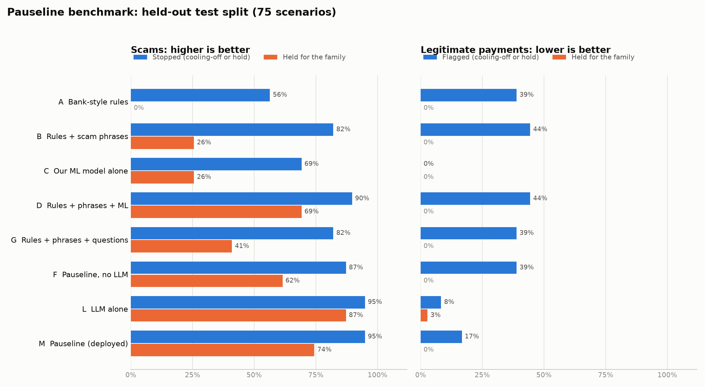

# Pauseline

**A pause before money leaves.** Pauseline protects people from being talked into sending money to scammers. It listens for scam pressure in how a payment is described, holds the money with a PayPal authorisation, and asks a trusted family member before anything is sent.

> Status: hackathon build (Threws Odyssey 2026 and PayPal AI Hackathon). PayPal **sandbox** only, so no real money moves. **Free to run:** our own on-device ML model plus an open-weight LLM on Groq's free tier, with no paid APIs.
>
> **Live demo:** https://pauseline-production.up.railway.app · **Results:** [EXPERIMENTS.md](EXPERIMENTS.md) · **Deploy:** [docs/DEPLOY.md](docs/DEPLOY.md)

## The problem

Today's biggest payment scams don't steal passwords. The real account owner makes the payment while a scammer directs them:

- a "bank fraud team" says to move savings to a **safe account**;
- "police" or "CBI" on a **video call** say the person is under **digital arrest**;
- a **grandchild in trouble** calls from a new number and asks for secrecy;
- fake tech support, romance, lottery, investment and task-job scams.

Conventional fraud checks look for stolen accounts. Here the owner is the one paying, so these checks often let it through. Families usually find out after the money is gone.

## What Pauseline does

1. **The payer pays as usual.** They pick who to pay and say what it's for, by typing or speaking in English, Hindi or a Hindi-English mix. They never have to "use AI".
2. **Pauseline checks for scam pressure:**
   - the payer's own words: a caller directing them, threats, secrecy, gift cards or crypto, a "safe account";
   - the context: a new payee, an amount far above usual, rapid repeat payments.
3. **If unsure, it asks one or two yes/no questions**, such as "Is someone on the phone with you right now, telling you what to do?"
4. **PayPal holds the money.** Every payment is an Orders v2 `AUTHORIZE`: the funds are reserved but not taken.
5. **Pauseline decides, in two tiers:**

   | Evidence | What happens |
   |---|---|
   | Nothing unusual | Captured at once, then sent to the recipient with PayPal Payouts |
   | Unusual context only (new payee, big amount) | One or two quick questions, then released if the answers and the AI find nothing wrong |
   | Some warning signs | **Cooling-off.** The payment appears in the family member's view (with an optional browser alert), and is released automatically later unless they decline. If the LLM is unavailable, unusual context alone also gets a cooling-off |
   | Strong warning signs in the words, or risky answers | **Held for the family member**, who sees the payer's words, the warning signs and the answers, then approves or declines |
   | Blocked payee | Voided at once |

   A declined payment is **voided**, so the payer is never charged.

**Safety principle:** no AI component can move money. Money moves only through deterministic policy or a human decision, and family decisions need the trusted contact's PIN. AI signals raise risk, with one tuned exception: while the LLM is working, risk from unusual context alone is capped lower, so a clean but unusual payment can go through after questions. If the LLM is unavailable, the stricter cap returns.

## How it uses PayPal

| PayPal API | Use |
|---|---|
| Orders v2 `intent: AUTHORIZE` + JS SDK button | The payer approves; PayPal holds the funds |
| Payments v2: authorise, capture, void | Hold, release or cancel based on the risk decision and the family's answer |
| Payouts | Deliver captured money to the recipient (Pauseline is the platform in the middle) |
| Webhooks + signature verification | Authorisation, capture, void and payout events feed the family timeline |
| `PayPal-Request-Id` | Idempotent calls: retries never double-charge |

## How it uses AI (all free)

| Part | What it does |
|---|---|
| **Scam-language classifier** (our own ML model) | TF-IDF over words and character n-grams, plus logistic regression (scikit-learn). Trained locally in about 8 seconds on 2,800 synthetic sentences in English, Hindi and Hinglish. Character n-grams cope with Hinglish spellings, Devanagari and speech-recognition errors. Each prediction comes with the phrases that drove it |
| Scam-phrase lexicon + context rules | Deterministic signals in English, Hindi and Hinglish: safe account, digital arrest, secrecy, gift cards, remote access, and more |
| Clarifying questions | 8 yes/no questions chosen from the strongest signals. Answers raise risk; reassuring answers lower it only slightly, because scammers coach victims |
| **Open-weight LLM** | **gpt-oss-120b on Groq's free tier** (chosen over gpt-oss-20b and Qwen 3.8 27B on our dev split). Gives a second opinion on risk, writes the calm message to the payer and the summary for the family in their language, and picks the most useful questions. Built for a shared free quota: answer cache, request/token budget guard, per-visitor rate limit, and automatic fallback to the on-device model. Can also run locally through Ollama |
| Speech | Browser Web Speech API for voice input and spoken results |

If the free LLM quota ever runs out, Pauseline keeps working on the on-device model, and the page footer shows which mode is active.

AI tools used to build it: Claude Code assisted with code, research and documentation, including drafting the benchmark scenarios. The team made the design decisions and reviewed all output.

## Results

Held-out test split, 75 scenarios (39 scams, 36 legitimate payments):



| | Scams caught | Scams held for the family | Legitimate payments flagged | Legitimate payments held |
|---|---|---|---|---|
| Bank-style rules (new payee, unusual amount) | 56% | 0% | 39% | 0% |
| Our ML model alone | 69% | 26% | 0% | 0% |
| LLM alone | 95% | 87% | 8% | 3% |
| **Pauseline (deployed)** | **95%** | **74%** | **17%** | **0%** |

- With 15% simulated speech-recognition errors, Pauseline still catches 95% of scams.
- Hindi and Hinglish scams: 100% caught.
- **Legitimate payments are never held for the family; every false alarm is a cooling-off delay.**
- Full method, confidence intervals, the error analysis and one documented re-tuning: [EXPERIMENTS.md](EXPERIMENTS.md).

## Research

- **Benchmark:** 112 hand-written synthetic scenarios.
  - 58 scams across 9 types, including 10 "coached" victims who deny everything, plus repeat payments and small-fee scams;
  - 54 legitimate payments, including tricky ones such as hospital deposits, bail paid at the courthouse and gift cards bought at a shop.
- **The classifier never sees the benchmark.** It trains on separate template-generated data, decontaminated against the benchmark: 0 exact duplicates, mean nearest-match similarity 0.49 (`eval/check_leakage.py`).
- **What we compare:** 8 conditions, from plain bank rules to the full Pauseline, 3 free LLMs, operating-point sweeps on the dev split, and robustness to Hindi, Hinglish and speech-recognition noise.

See [EXPERIMENTS.md](EXPERIMENTS.md).

## Run it

Requires Python 3.11+ and [uv](https://docs.astral.sh/uv/). Everything is free.

```bash
uv sync --all-extras
cp .env.example .env          # optional: PayPal sandbox keys and a free Groq key
uv run pauseline              # http://127.0.0.1:8000 (first start trains the classifier, ~8 s)
```

With no keys it runs fully offline: a fake PayPal with the same state rules, and the on-device model. The page footer shows the active mode.

**Try it:**
- **Send money:** pay "Rahul" 80 for "college books" → released at once.
- **Send money:** pay "Safe Account Services" 3000 with "The bank officer said my account is hacked, I must move my savings to a safe account, he is still on the phone" → questions, then held.
- **Family view:** enter the family PIN (`1234` unless `PAUSELINE_FAMILY_PIN` is set), see the hold with the reasons, then decline it → the PayPal authorisation is voided.

```bash
uv run pytest                                  # tests
uv run python eval/run.py --split dev          # benchmark, all free conditions
uv run python eval/sweep.py                    # operating-point sweep (dev)
uv run python eval/check_leakage.py            # train/benchmark overlap
uv run python eval/run.py --split dev --llm    # + LLM conditions (Groq free tier; answers are cached)
```

## Project layout

```
src/pauseline/
  risk/        signals.py (rules + lexicon) · classifier.py + training_data.py (ML) · questions.py
               llm.py (Groq / Ollama, quota guard, cache) · engine.py (decision policy)
  paypal/      client.py (sandbox REST client + fake with the same rules)
  service.py   payment lifecycle: assess → ask → hold → release / cancel
  app.py       FastAPI: payer screens, family dashboard, API, webhooks
eval/
  scenarios/   build_v1.py → v1.jsonl (frozen, sha256 in MANIFEST.json)
  run.py · sweep.py · sweep_llm.py · check_leakage.py · perturb.py (speech noise) · charts.py
Dockerfile · railway.json · render.yaml · scripts/register_webhook.py · docs/DEPLOY.md · docs/SUBMISSION.md
tests/
```

## Limitations

- Sandbox only, with synthetic scenarios and no real user data. The benchmark is small, so we report 95% confidence intervals.
- The classifier learns from template-generated data. It generalises to the hand-written benchmark, but real scam scripts change; retraining is cheap and local.
- Pauseline only sees payments made through it. In practice it would be a feature that a wallet or bank adds.
- A coached victim paying a scammer they already saved, with a bland description, is close to undetectable from words (see EXPERIMENTS.md).

## License

[MIT](LICENSE). Team Beyonders: Viranshul ([@Viranshul-P](https://github.com/Viranshul-P)), Priyanshu Doshi ([@Priyanshu-byte-coder](https://github.com/Priyanshu-byte-coder)), Kuldeep Goklani ([@Kuldeeep18](https://github.com/Kuldeeep18)). Hackathon notes: [docs/HACKATHON.md](docs/HACKATHON.md).
